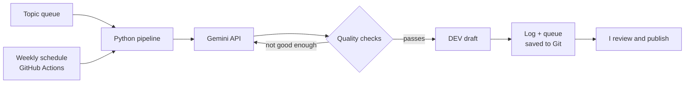

# Blog Automation Pipeline

I write technical posts about AI, data and testing, and I wanted a system that does the boring parts for me without ever publishing something I haven't read. So I built one.

Every Tuesday, a GitHub Actions job picks the next topic from my queue, asks the Gemini API for a draft, checks that draft against my own quality rules, and drops it into my [DEV](https://dev.to/rafiacloud) account as an unpublished draft. I read it, fix what needs fixing, and hit publish myself.

The code lives in a private repo. If you're hiring and want to look through it, send me a message (details at the bottom) and I'll give you access.

## How it works

- **Topic queue:** a simple CSV with the topic, the angle I want, and tags.
- **Drafting:** Gemini returns a structured reply (title, description, article body) that follows a JSON schema, so I'm not parsing loose text.
- **Quality checks:** length, at least three sections, a key takeaways section, and a list of filler phrases I don't want in my writing. If a draft fails, the pipeline tells the model what was wrong and tries once more.
- **Publishing:** posts go to DEV as drafts only. Nothing goes live without me.
- **Record keeping:** every run is written to a log and committed back to the repo, so I can always see what happened and when.

## What broke, and how I fixed it

The first real runs taught me more than the build itself. Four things went wrong:

1. **The model I asked for didn't exist any more.** Google had retired the model name in my code, so every request came back 404. Now the pipeline asks the API which models are available and picks the newest stable one.
2. **The model's reply had extra text after the JSON.** My parser crashed. I added a response schema to the request, made the parsing tolerant of stray text, and added retries with backoff.
3. **An API key was saved with blank lines after it.** The request was rejected as an invalid header. Keys are now cleaned before they're used.
4. **That error message leaked part of the key into my log file.** This was the important one. I rotated the key, cleaned the log, and made every message go through a redaction step before it's printed or saved. There's a test for it now.

## Built with

Python, the Gemini API, the DEV (Forem) REST API, GitHub Actions (scheduled runs, secrets, artifacts) and pytest. There are 11 unit tests, and they run before every pipeline run. The whole thing costs nothing to run.

## First result

The first real run produced a 1,229-word article, *What is Physical AI? Perception, Planning and Control Explained*, which passed every check and arrived in my DEV drafts in under a minute.

---

**Rafia Imran** · Munich / remote
[Live CV](https://rafiaimran.cloud) · [Blog on DEV](https://dev.to/rafiacloud) · [LinkedIn](https://www.linkedin.com/in/rafia-i-b64664276) · imranrafia25789@gmail.com
