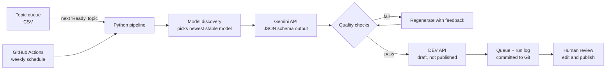

# Blog Automation Pipeline

**An automated pipeline that turns a topic queue into reviewed technical blog posts on [DEV](https://dev.to/rafiacloud).** It runs every week on GitHub Actions, writes with the Gemini API, checks its own output, and stops at a human review step before anything is published.

> The source code is in a private repository. **Access is available on request** for recruiters and hiring teams. Contact details are at the bottom of this page.

---

## What it does

1. I add topic ideas (topic, angle, tags) to a queue file.
2. Every Tuesday, a scheduled GitHub Actions job picks the next topic.
3. The Gemini API writes a structured draft (title, description, Markdown body).
4. Automated quality checks verify length, structure, a takeaways section, and that filler phrases are absent. A failing draft is regenerated once with the problems fed back to the model.
5. The draft is sent to the DEV REST API as an **unpublished draft**.
6. The queue and a run log are updated and committed back to the repo, so every run is traceable.
7. I review, edit and publish the post on DEV.

## Architecture

## Engineering decisions

| Decision | Why |
|---|---|
| **Drafts only, human review before publishing** | AI output is never published automatically; quality and accuracy stay my responsibility. |
| **Structured output with a JSON schema** | The model must return `title`, `description` and `body_markdown`, so parsing doesn't depend on free text. |
| **Automatic model selection** | Model names change. The pipeline asks the API which models are available and picks the newest stable one instead of hard-coding a name. |
| **Retries with backoff** | Rate limits, server errors and malformed replies are retried up to three times before the run fails. |
| **Secret handling** | API keys live in GitHub Secrets, are cleaned of stray whitespace, and are redacted from all logs and error messages. |
| **State in Git** | The topic queue and run log are plain CSV files, so the history of every run is visible and auditable. |
| **Tests in CI** | 11 unit tests (quality checks, tag cleaning, model selection, reply parsing, secret redaction) run before every pipeline run. |

## Problems found and fixed in production

Getting from "works in tests" to "runs for real" surfaced four issues, each fixed at the root:

1. **Retired model name**: the provider retired the model the code requested, so the API returned 404. *Fix:* automatic model discovery.
2. **Malformed model reply**: the model returned valid JSON followed by extra text, which crashed the parser. *Fix:* a JSON schema in the request, lenient parsing and retries.
3. **Badly pasted API key**: a key saved with trailing newlines was rejected as an invalid header. *Fix:* keys are normalised before use.
4. **Secret exposed in a log**: the error message for issue 3 contained the key and was written to the run log. *Fix:* the key was rotated and the log cleaned, and all output now passes through a redaction step, with a test covering it.

## Results

- First real run: a **1,229-word** draft generated, checked and delivered to DEV in under a minute
- Runs weekly with no manual steps until review
- **Runs at no cost**: GitHub Actions, the Gemini API free tier and the DEV API

## Tech stack

Python · Gemini API · DEV (Forem) REST API · GitHub Actions (cron, secrets, artifacts) · pytest · CSV as a lightweight data store

---

**Rafia Imran**, AI product development and automation · Munich / remote
Live CV: [rafiaimran.cloud](https://rafiaimran.cloud) · Blog: [dev.to/rafiacloud](https://dev.to/rafiacloud) · LinkedIn: [linkedin.com/in/rafiaim](https://www.linkedin.com/in/rafiaim)

**Want to see the code?** Message me on LinkedIn or email imranrafia25789@gmail.com and I'll add you to the private repository.
